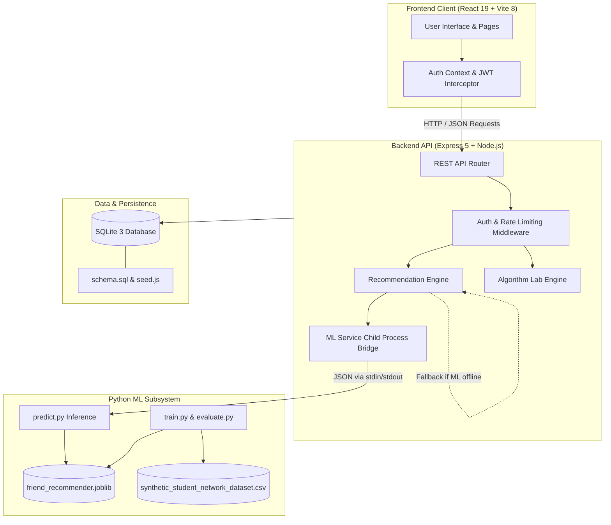

# AffinityAI — Intelligent Friend Recommendation System

> **AI/ML-Powered Academic & Social Discovery Platform with Graph Theory & Algorithm Laboratory**  
> *A full-stack computer science project combining graph algorithms, academic profile matching, and supervised machine learning link prediction.*

---

## 1. Project Title & Overview

**AffinityAI** is a full-stack, AI/ML-driven student recommendation system designed for university campuses. On modern academic campuses, students often find it difficult to identify peers with aligned coursework, research interests, complementary technical skills, or shared academic trajectories. Traditional platforms either rely solely on popularity or simple keyword matching.

AffinityAI solves this problem using a **two-stage hybrid recommendation pipeline**:
1. **Candidate Generation**: Discovers candidate peers using structural graph traversal (2-hop triadic closure: *friends-of-friends*) combined with cold-start academic discovery for new students with zero or few friends.
2. **Candidate Ranking**: Evaluates candidate pairs using a **supervised Machine Learning link prediction model** (standardized Logistic Regression with calibrated probability) backed by a transparent **graph heuristic baseline** with automatic graceful fallback.

In addition to intelligent recommendations, AffinityAI includes an interactive **Algorithm Laboratory** demonstrating fundamental Data Structures and Algorithms (Graph Traversal, Kruskal's Minimum Spanning Tree with Disjoint Set Union, and Kahn's DAG Topological Sorting), plus a **Role-Based Administrator Portal** with live network analytics and AI/ML model monitoring.

---

## 2. Main Objectives

- **Intelligent Peer Discovery**: Connect university students based on shared academic topics, coursework interests, and social network proximity.
- **Cold-Start Resilience**: Ensure new students with zero connections receive high-quality recommendations based on normalized academic interests rather than empty lists.
- **Explainable Machine Learning**: Use a transparent supervised link prediction model (Logistic Regression) where every recommendation score is explainable through 7 mathematical features.
- **Fail-Safe Robustness**: Guarantee 100% platform availability through an automatic fallback to graph heuristic calculations whenever Python or the ML model artifact is offline.
- **Educational DSA Demonstrations**: Differentiate social network graph algorithms from discrete infrastructure algorithms (Kruskal's MST) and scheduling algorithms (Kahn's Topological Sort).
- **Administrative Governance & Privacy**: Provide administrators with aggregated platform metrics and user controls while strictly protecting student privacy (zero message snooping, salted password hashes).

---

## 3. Key Features

### Student Features
- **Registration & Authentication**: Secure account creation with name, email, password, bio, and academic interests; protected by salted bcrypt password hashing and JSON Web Tokens (JWT).
- **Student Dashboard**: Quick overview of connection counts, pending incoming/outgoing friend requests, and top suggested peers.
- **Intelligent Recommendations**: AI-ranked friend suggestions displaying match percentages, common friends, and shared academic topics with explainable rationale.
- **Connections & Requests Management**: Dedicated views to browse confirmed friends, view outgoing requests, and accept or reject incoming invitations.
- **Friend-Only Direct Messaging**: Direct 1-on-1 messaging strictly restricted to confirmed friends (`FriendService.areFriends`), powered by periodic client polling (every 3.5 seconds) with optimistic UI updates, unread counters, and chronological message history. (Note: The messaging module is polling-based and does not use WebSockets).
- **Student Directory & Search**: Browse campus students with real-time name and interest filtering.
- **Profile Management**: Update personal bio and academic interests with instant feedback on recommendation quality.

### Administrator Features
- **Admin Overview**: Real-time aggregate platform statistics including total users, students, administrators, confirmed friendships, pending/accepted/rejected friend requests, message volume, network average degree, and graph density.
- **User Directory Management**: View all registered users, their connection counts, and request statistics. Safely toggle student account status (`active` / `inactive`) to prevent unauthorized login, with built-in safeguards blocking self-deactivation and admin modification.
- **Platform Analytics**: Visual distributions of student degree buckets (0 friends, 1-2 friends, 3-4 friends, 5+ friends), real student topic affinity rankings, request conversion rate, active chat pairs, and student-only network density.
- **AI/ML Monitoring**: Live inspection of ML inference availability, training metadata, authoritative holdout evaluation metrics, top-K precision ($P@1, P@3, P@5$), 7 explainable feature coefficients, and recommendation pipeline stages.

### AI/ML Features
- **Two-Stage Recommendation Pipeline**: Candidate generation via 2-hop BFS and cold-start fallback, followed by candidate ranking via supervised machine learning.
- **7 Explainable Features**: Structural features (`mutual_friends`, `friend_jaccard`, `target_degree`, `candidate_degree`, `adamic_adar_approx`) and academic homophily features (`shared_interests`, `interest_jaccard`).
- **Academic Topic Synonym Normalization**: Canonical taxonomy mapping variations across 13 computer science domains (e.g., "AI" / "Artificial Intelligence", "Full-Stack" / "Web Development", "CTF" / "Cybersecurity").
- **Probability Calibration**: Logistic sigmoid function $P(y=1 \mid \mathbf{x}) = \frac{1}{1 + e^{-(\beta_0 + \mathbf{w}^T \mathbf{x})}}$ producing calibrated match probabilities between $0\%$ and $99\%$.
- **Graceful Fallback**: Transparent heuristic baseline scoring kicks in automatically if Python or the serialized `.joblib` model is unavailable.

### Algorithm Lab
- **Friendship Graph Traversal**: Visual representation of the student social network $G = (V, E)$, demonstrating 2-hop BFS neighborhood discovery and exclusion filtering.
- **Kruskal's Minimum Spanning Tree (MST)**: Greedy algorithm with Disjoint Set Union (DSU, union by rank and path compression) finding the minimal total edge weight backbone connecting campus server nodes.
- **Kahn's Topological Sorting**: BFS-based in-degree algorithm computing valid linear prerequisite sequences for Directed Acyclic Graphs (DAGs) with cycle detection.
- *Clear Algorithmic Differentiation*: Explicitly explains why MST (infrastructure cost minimization) and Topological Sort (directed acyclic task ordering) are distinct from peer similarity matching.

---

## 4. Technology Stack

| Layer | Technologies | Purpose |
| :--- | :--- | :--- |
| **Frontend** | React 19, Vite 8, Pure Vanilla CSS, Lucide React Icons | High-performance Single Page Application (SPA), instant hot-reloading, zero CSS framework bloat |
| **Backend API** | Node.js (v18–v24), Express 5 | RESTful API, role-based authorization, rate limiting, and process orchestration |
| **Database** | SQLite 3 via `better-sqlite3` | Zero-configuration embedded SQL database, ACID transactions, WAL mode, foreign keys |
| **Machine Learning** | Python 3, scikit-learn, NumPy, pandas, joblib, pytest | Supervised link prediction, feature scaling, model serialization, offline evaluation |
| **Security & Auth** | `bcryptjs`, `jsonwebtoken` (JWT), sliding-window rate limiter | Salted password hashing, stateless session verification, brute-force mitigation |
| **Testing** | Node.js native test runner (`node:test`), `supertest`, `pytest` | 100% automated test suites for both API endpoints and ML feature/inference pipelines |

*100% self-contained — Zero third-party paid APIs, cloud subscriptions, or external AI services required.*

---

## 5. System Architecture



---

## 6. Project Folder Structure

```
AffinityAI/
├── .gitignore                       # Excludes node_modules, build outputs, DB files, and secrets
├── .env.example                     # Root environment configuration template with safe placeholders
├── package.json                     # Monorepo orchestration scripts for server, client, and ML
├── README.md                        # Master project documentation
│
├── client/                          # React 19 + Vite Frontend Application
│   ├── public/                      # Static assets and icons
│   ├── src/
│   │   ├── algorithms/              # Client-side graph formatting utilities
│   │   ├── components/              # Reusable UI components (Sidebar, Topbar, UserCard, Toast)
│   │   ├── context/                 # AuthContext (JWT session management and state)
│   │   ├── pages/                   # Application views
│   │   │   ├── Admin.jsx            # Admin portal tab wrapper
│   │   │   ├── AdminAnalytics.jsx   # Network degree, topic rankings, conversion charts
│   │   │   ├── AdminML.jsx          # Live ML monitoring, weights, evaluation metrics
│   │   │   ├── AdminOverview.jsx    # Platform counts, active model status, system stats
│   │   │   ├── AdminUsers.jsx       # Student user management & status toggle
│   │   │   ├── Dashboard.jsx        # Student home overview and recommendations preview
│   │   │   ├── DsaLab.jsx           # Interactive Kruskal MST, Kahn Topo Sort, Traversal
│   │   │   ├── Friends.jsx          # Confirmed friends and incoming/outgoing request manager
│   │   │   ├── Login.jsx            # Student & administrator authentication
│   │   │   ├── Messages.jsx         # Direct 1-on-1 friend chat with unread counters
│   │   │   ├── Profile.jsx          # Student profile & academic interest configuration
│   │   │   ├── Recommendations.jsx  # Full AI recommendation catalog with match details
│   │   │   ├── Register.jsx         # Student registration form
│   │   │   └── Search.jsx           # Student peer search directory
│   │   ├── services/
│   │   │   └── api.js               # Centralized fetch client with automatic JWT bearer header
│   │   ├── App.jsx                  # Main application router and role-based views
│   │   ├── index.css                # Base typography and reset rules
│   │   ├── main.jsx                 # Application entry point
│   │   └── styles.css               # Clean modern design system
│   ├── package.json                 # Frontend dependencies (React, Vite, Lucide)
│   ├── vite.config.js               # Vite bundler configuration
│   └── README.md                    # Frontend client documentation
│
└── server/                          # Express Backend & Python ML Subsystem
    ├── algorithms/                  # Core Algorithmic Implementations
    │   ├── kahnTopologicalSort.js   # Kahn's BFS algorithm for DAG topological sort
    │   ├── kruskalMST.js            # Kruskal's algorithm with Disjoint Set Union (DSU)
    │   └── recommendation.js        # 2-hop BFS, topic extraction, and hybrid ML pipeline
    ├── database/                    # Persistence Layer
    │   ├── db.js                    # Database connector with WAL mode and migrations
    │   ├── schema.sql               # SQLite schema with foreign keys and indexes
    │   └── seed.js                  # Safe database seeding script with development guards
    ├── middleware/
    │   ├── auth.js                  # JWT verification & requireAdmin authorization
    │   └── rateLimiter.js           # Sliding-window rate limiter for sensitive routes
    ├── ml/                          # Dedicated Python Machine Learning Module
    │   ├── data/                    # Benchmark dataset directory
    │   │   └── synthetic_student_network_dataset.csv
    │   ├── model/                   # Serialized model artifact and metadata
    │   │   ├── evaluation_report.json
    │   │   ├── friend_recommender.joblib
    │   │   └── model_meta.json
    │   ├── tests/
    │   │   └── test_ml.py           # 8 automated unit tests for ML pipeline
    │   ├── dataset.py               # Synthetic educational benchmark generator
    │   ├── evaluate.py              # Comparative evaluation script vs heuristic baseline
    │   ├── features.py              # 7-feature extraction and synonym normalizer
    │   ├── predict.py               # JSON stdin/stdout inference subprocess interface
    │   ├── pytest.ini               # Pytest configuration
    │   ├── requirements.txt         # Python dependencies (scikit-learn, numpy, pandas)
    │   └── train.py                 # Training script for Logistic Regression & Random Forest
    ├── routes/                      # Modular REST API Route Handlers
    │   ├── admin.js                 # Admin stats, user management, analytics, ML monitoring
    │   ├── auth.js                  # User registration, login, session inspection
    │   ├── dsa.js                   # Graph visualization, Kruskal MST, Kahn Topo Sort
    │   ├── friends.js               # Friend requests, accept, reject, friendship lists
    │   ├── messages.js              # 1-on-1 friend messaging and unread counts
    │   ├── recommendations.js       # Hybrid ML friend recommendation endpoint
    │   └── users.js                 # Profile retrieval, updates, directory search
    ├── services/
    │   ├── friendService.js         # Friendship transactional business logic
    │   └── mlService.js             # Node.js child-process bridge to Python ML engine
    ├── tests/
    │   ├── algorithms.test.js       # Unit tests for recommendation, Kruskal, and Kahn
    │   └── api.test.js              # Integration tests for auth, friends, messaging, admin
    ├── .env.example                 # Backend environment variable template
    ├── app.js                       # Express app configuration, CORS, error handling
    ├── package.json                 # Backend dependencies (Express, better-sqlite3, bcryptjs)
    └── server.js                    # HTTP listener startup script
```

---

## 7. Prerequisites & Software Requirements

Before installing, ensure the following software is installed on your computer:

| Software | Minimum Version | Recommended Version | Verify Command |
| :--- | :--- | :--- | :--- |
| **Node.js** | `v18.0.0` | `v24.x` | `node -v` |
| **npm** | `v9.0.0` | `v11.x` | `npm -v` |
| **Python** | `3.9` | `3.11` to `3.14` | `py --version` (Win) or `python3 --version` |
| **Git** | `v2.30.0` | Latest | `git --version` |

---

## 8. Installation Instructions (Windows PowerShell)

Open a **Windows PowerShell** terminal and run the following commands step by step:

```powershell
# 1. Clone the repository
git clone https://github.com/Jetson17/AffinityAI.git
Set-Location AffinityAI

# 2. Install all root, server, and client dependencies in one command
npm run install:all
```

*Note: Alternatively, you can install server and client dependencies separately:*
```powershell
# Install backend dependencies
cd server
npm install

# Install frontend dependencies
cd ../client
npm install
cd ..
```

---

## 9. Environment Variables Configuration

The backend requires an environment configuration file (`server/.env`). A template is provided at `.env.example` in both the project root and `server/`.

### Step 1: Create `server/.env`
In PowerShell from the project root:
```powershell
Copy-Item .env.example server/.env
```

### Step 2: Review Environment Variables
The `.env.example` file contains safe defaults for local development:

```env
# Port on which Express backend runs
PORT=5000

# Node environment mode
NODE_ENV=development

# JWT Secret Key (Must be at least 32 characters in production)
JWT_SECRET=replace_with_a_secure_random_at_least_32_characters_secret_key

# Allowed CORS client origins (comma-separated)
CLIENT_ORIGIN=http://localhost:5173,http://127.0.0.1:5173

# Python executable command: 'py' on Windows, 'python3' on macOS/Linux
PYTHON_PATH=py
```

---

## 10. Python ML Environment Setup & Training

The machine learning recommendation engine uses standard Python data science libraries.

### Step 1: Install Python Dependencies
Open PowerShell from the project root:
```powershell
cd server/ml
py -m pip install -r requirements.txt
cd ../..
```

### Step 2: Train the Machine Learning Model
Train the supervised link prediction model and save the serialized weights:
```powershell
npm run ml:train
```
*(Or from `server/ml/`: `py train.py`)*

This script:
1. Generates the synthetic student benchmark dataset (`server/ml/data/synthetic_student_network_dataset.csv`).
2. Extracts the 7 candidate-pair features.
3. Fits the `StandardScaler` and `LogisticRegression` link prediction model.
4. Serializes the trained model to `server/ml/model/friend_recommender.joblib`.
5. Saves feature coefficients and metrics to `server/ml/model/model_meta.json`.

### Step 3: Run Model Evaluation (Optional)
To compare the ML model against the heuristic baseline:
```powershell
npm run ml:evaluate
```

---

## 11. Database Initialization & Demo Data Seeding

AffinityAI uses SQLite with `better-sqlite3`. The database schema is created automatically whenever the backend starts. To populate the system with realistic university demo accounts, friendships, friend requests, and chat messages:

```powershell
npm run seed
```
*(Or from `server/`: `node database/seed.js`)*

### Seeding Safeguards
- In development, the seed script checks whether users already exist. It **preserves existing data** unless `--force` is passed: `node database/seed.js --force`.
- In production (`NODE_ENV=production`), destructive database resets are **strictly blocked** to prevent data loss.

### Default Demo Credentials

| Role | Name | Email | Password | Academic Interests |
| :--- | :--- | :--- | :--- | :--- |
| **Student** | Alice Johnson | `alice@demo.com` | `password123` | Graph Theory, Algorithms, Web Development |
| **Student** | Bob Smith | `bob@demo.com` | `password123` | Robotics, AI, Machine Learning |
| **Student** | Charlie Brown | `charlie@demo.com` | `password123` | Web Development, UI/UX Design, React |
| **Student** | Diana Prince | `diana@demo.com` | `password123` | Cybersecurity, Distributed Systems |
| **Student** | Evan Wright | `evan@demo.com` | `password123` | Data Science, Mathematics, Machine Learning |
| **Administrator** | System Admin | `admin@demo.com` | `password123` | *Platform Administration & Security* |

---

## 12. Starting the Application

To run the complete application, open **two separate PowerShell terminals**:

### Terminal 1: Start Backend Server
From the project root:
```powershell
npm run server
```
- **Backend URL**: `http://localhost:5000`
- **Health Check**: `http://localhost:5000/api/health`

### Terminal 2: Start Frontend Client
From the project root:
```powershell
npm run client
```
- **Frontend URL**: `http://localhost:5173`

Open your web browser and navigate to `http://localhost:5173`.

---

## 13. How to Use the Application

### Student Workflow
1. **Login**: Go to `http://localhost:5173`, choose student demo credentials (e.g., `alice@demo.com` / `password123`) or register a new student account.
2. **Dashboard**: View your total friend count, incoming pending requests, and top suggested peers.
3. **Explore Recommendations**: Click **Recommendations** in the sidebar. Each suggestion displays:
   - Predicted Connection Score ($0\% - 99\%$)
   - Mutual friends count with preview names
   - Shared academic topics
   - Clear explainable rationale for why this person was suggested.
4. **Send Friend Requests**: Click **Add Friend** on any recommendation or user card.
5. **Manage Requests & Friends**: Navigate to **Friends** to review incoming requests. Click **Accept** to establish a confirmed mutual friendship or **Decline** to dismiss.
6. **Direct Messaging**: Click **Messages** to chat with any confirmed friend. The client periodically polls for new messages every 3.5 seconds with optimistic local message delivery. Unread badges update automatically. Note: Students cannot message users who are not confirmed friends, and administrators cannot participate in student chats.
7. **Profile Configuration**: Click **Profile** to update your bio or select academic interest tags. The recommendation engine immediately factors in your updated interests on your next discovery refresh.

### Administrator Workflow
1. **Login**: Sign in with administrative credentials: `admin@demo.com` / `password123`.
2. **Admin Overview**: The dashboard displays platform counts (users, students, admins, friendships, requests, messages), average degree, graph density, and active ML model health.
3. **User Management**: Click **User Directory** to see all registered accounts, friend counts, and request activity. Use the **Status Toggle** button to deactivate or reactivate accounts. Self-deactivation and admin modification are strictly prevented.
4. **Platform Analytics**: Click **Platform Analytics** to view the student network degree distribution chart, academic topic frequency rankings, friend request conversion rate, and messaging volume.
5. **AI/ML Monitoring**: Click **AI/ML Monitoring** to inspect:
   - Live ML model availability and production model name
   - Synthetic educational benchmark disclosure
   - Authoritative holdout test evaluation metrics (Accuracy, Precision, Recall, F1, ROC-AUC, $P@K$)
   - Learned feature weights (coefficients) for all 7 ranking features
   - Complete 4-stage pipeline explanation.
6. **Algorithm Lab**: Click **Algorithm Lab** to interactively test Kruskal's Minimum Spanning Tree and Kahn's DAG Topological Sorting with step-by-step traces.

---

## 14. API Overview

All API endpoints are prefixed with `/api`. Protected routes require a valid JWT token passed in the `Authorization: Bearer <token>` header.

### Public & Authentication Endpoints
| Method | Endpoint | Access | Description |
| :--- | :--- | :--- | :--- |
| `GET` | `/api/health` | Public | Service health check and current timestamp |
| `POST` | `/api/auth/register` | Public (Rate Limited) | Register a new student account |
| `POST` | `/api/auth/login` | Public (Rate Limited) | Authenticate user and receive JWT session token |
| `GET` | `/api/auth/me` | Authenticated | Retrieve current user profile and friendship statistics |

### Student & Profile Endpoints
| Method | Endpoint | Access | Description |
| :--- | :--- | :--- | :--- |
| `GET` | `/api/users` | Authenticated | Browse student directory with query search filtering |
| `GET` | `/api/users/:id` | Authenticated | View a student's public profile and structured interests |
| `PUT` | `/api/users/profile` | Authenticated | Update logged-in user profile, bio, and academic topics |

### Friend & Social Network Endpoints
| Method | Endpoint | Access | Description |
| :--- | :--- | :--- | :--- |
| `GET` | `/api/friends` | Authenticated | List all confirmed mutual friends of the logged-in student |
| `GET` | `/api/friends/requests` | Authenticated | List all incoming and outgoing pending friend requests |
| `POST` | `/api/friends/request/:targetId` | Authenticated (Students only) | Send a friend request to a candidate student (Admin accounts blocked) |
| `POST` | `/api/friends/request/:id/accept` | Authenticated | Accept a received pending friend request |
| `POST` | `/api/friends/request/:id/reject` | Authenticated | Reject a received pending friend request |

### Recommendation Endpoints
| Method | Endpoint | Access | Description |
| :--- | :--- | :--- | :--- |
| `GET` | `/api/recommendations` | Authenticated (Students only) | Retrieve hybrid ML-ranked recommendations for current user (Admins blocked) |

### Messaging Endpoints (Friend-Only)
| Method | Endpoint | Access | Description |
| :--- | :--- | :--- | :--- |
| `GET` | `/api/messages/:friendId` | Authenticated (Friends only) | Retrieve chronological chat history with a confirmed friend |
| `POST` | `/api/messages/:friendId` | Authenticated (Friends only) | Send a direct message to a confirmed friend |
| `POST` | `/api/messages/:friendId/read` | Authenticated (Friends only) | Mark messages from a friend as read |
| `GET` | `/api/messages/unread-counts` | Authenticated | Get unread message counts grouped by sender |

### Administrator Endpoints (Role: `admin` required)
| Method | Endpoint | Access | Description |
| :--- | :--- | :--- | :--- |
| `GET` | `/api/admin/stats` | Admin | Platform counts, network degree, graph density, model status |
| `GET` | `/api/admin/users` | Admin | Directory of all users with friend counts and active status |
| `PUT` | `/api/admin/users/:id/status` | Admin | Toggle account active/inactive status (with self-protection) |
| `GET` | `/api/admin/analytics` | Admin | Degree buckets, topic affinity rankings, conversion rates |
| `GET` | `/api/admin/ml-monitoring` | Admin | ML inference status, 7 feature weights, holdout metrics |

### Algorithm Lab Endpoints (Role: `admin` required)
| Method | Endpoint | Access | Description |
| :--- | :--- | :--- | :--- |
| `GET` | `/api/dsa/friendship-graph` | Admin | Complete graph vertices, edges, and 2-hop traversal |
| `GET` | `/api/dsa/mst` | Admin | Run Kruskal's MST on campus communication backbone graph |
| `POST` | `/api/dsa/mst` | Admin | Execute Kruskal's MST on custom submitted graph |
| `GET` | `/api/dsa/topological-sort` | Admin | Run Kahn's algorithm on course prerequisite DAG |
| `POST` | `/api/dsa/topological-sort` | Admin | Execute Kahn's algorithm on custom submitted DAG |

---

## 15. The Recommendation Model & Seven Ranking Features

### Two-Stage Pipeline Architecture

```
[Target Student (u)]
        |
        v
1. Filter Exclusions:
   - Exclude target student themselves (u)
   - Exclude existing confirmed friends F(u)
   - Exclude pending friend requests (sent or received)
   - Exclude system administrators (privileged accounts)
        |
        v
2. Candidate Pool Generation:
   - Primary: 2-Hop Graph Traversal (Triadic Closure: peers with mutual friends)
   - Cold-Start: Students sharing normalized academic topics or active community members
        |
        v
3. Pairwise Feature Extraction (7 Explainable Features per Candidate v)
        |
        v
4. Supervised Link Prediction Scoring:
   - If ML Model Available: Evaluate calibrated probability via Logistic Regression
   - If ML Unavailable: Fall back to transparent Graph Affinity Heuristic formula
        |
        v
5. Deterministic Hybrid Ranking:
   - Rank candidates by Predicted Score (descending) -> Mutual Friends (descending) -> Alphabetical Name
```

### The Seven Mathematical Features

Every candidate pair $(u, v)$ is evaluated on 7 explainable features before ranking:

| # | Feature Name | Mathematical Definition | Interpretation & Learned Weight |
| :-: | :--- | :--- | :--- |
| 1 | `adamic_adar_approx` | $\sum_{w \in F(u) \cap F(v)} \frac{1}{\log |F(w)|}$ | **Strongest Positive Structural Predictor (+1.7210)**. Weights shared niche connections much higher than shared popular hubs. |
| 2 | `shared_interests` | $\|T(u) \cap T(v)\|$ | **Strongest Academic Homophily Predictor (+1.0180)**. Count of overlapping canonical topics normalized from bio and interests. |
| 3 | `mutual_friends` | $\|F(u) \cap F(v)\|$ | **Triadic Closure Signal (+0.9236)**. Count of confirmed shared friends. |
| 4 | `friend_jaccard` | $\frac{\|F(u) \cap F(v)\|}{\|F(u) \cup F(v)\|}$ | **Community Alignment (+0.4841)**. Proportional neighborhood overlap in the social graph. |
| 5 | `candidate_degree` | $\|F(v)\|$ | **Hub Bias Mitigation (-0.3283)**. Negative coefficient prevents popular accounts from monopolizing recommendations. |
| 6 | `target_degree` | $\|F(u)\|$ | **Degree Normalization (-0.6240)**. Balances scoring for active versus cold-start users. |
| 7 | `interest_jaccard` | $\frac{\|T(u) \cap T(v)\|}{\|T(u) \cup T(v)\|}$ | **Topic Breadth Regularizer (-0.1982)**. Penalizes overly diluted interest lists. |

### Supervised Logistic Regression Formulation
- **Probability Calibration**:
  $$P(\text{friendship} \mid \mathbf{x}) = \frac{1}{1 + e^{-(\beta_0 + \sum_{i=1}^7 \beta_i x_i)}}$$
- **Connection Match Score**: $\text{round}(P(\text{friendship}) \times 100)\%$

### Heuristic Baseline Formula (Graceful Fallback)
When running without the Python ML engine:
$$\text{Score} = \min\left(99,\; 5 + \min(75, |F_u \cap F_v| \times 25) + \min(20, |T_u \cap T(v)| \times 10)\right)$$

---

## 16. Machine Learning Benchmark Results

> **Educational Benchmark Disclosure**: The machine learning model was trained and evaluated on an educational benchmark dataset simulating 120 university computer science students across academic cohorts (AI/Robotics, Systems/Cybersecurity, Web/Full-Stack, Data/Math) to ensure reproducible academic demonstration without leaking private user data.

### Holdout Test Set Evaluation Results ($N = 136$ Test Pairs)

*Verified directly from `server/ml/model/evaluation_report.json` and `model_meta.json`:*

| Metric | Heuristic Baseline | ML Model (Logistic Regression) | Random Forest Benchmark |
| :--- | :---: | :---: | :---: |
| **Accuracy** | 0.8824 | **0.8897** | **0.8971** |
| **Precision** | 0.8750 | **0.8947** | **0.8974** |
| **Recall** | **0.7778** | 0.7556 | **0.7778** |
| **F1-Score** | 0.8235 | 0.8193 | **0.8333** |
| **ROC-AUC** | 0.9377 | 0.9286 | **0.9431** |
| **Precision@1** | 0.4878 | **0.5122** | **0.5122** |
| **Precision@3** | 0.3333 | **0.3415** | 0.3415 |
| **Precision@5** | 0.3260 | 0.3260 | 0.3260 |

---

## 17. Algorithm Lab Demonstrations

The Algorithm Lab demonstrates three distinct computational concepts:

### 1. Friend Recommendation Graph Traversal
- **Data Structure**: Undirected Graph $G = (V, E)$ represented via adjacency list `Map<number, Set<number>>`.
- **Algorithm**: 2-Hop Breadth-First Search (BFS) discovering candidate peers within distance 2 (triadic closure).
- **Time Complexity**: $\mathcal{O}(V + E)$.

### 2. Kruskal's Minimum Spanning Tree (MST)
- **Data Structure**: Disjoint Set Union (DSU) with Path Compression and Union by Rank.
- **Problem**: Finds the minimal communication backbone connecting campus server nodes with minimum total link cost without introducing cycles.
- **Time Complexity**: $\mathcal{O}(E \log E)$ for edge sorting + $\mathcal{O}(E \cdot \alpha(V))$ for DSU operations.
- *Distinction*: MST optimizes global edge weight across infrastructure nodes; it is completely distinct from peer similarity matching.

### 3. Kahn's Topological Sorting
- **Data Structure**: Directed Acyclic Graph (DAG) using in-degree frequency array and BFS queue.
- **Problem**: Computes valid linear prerequisite sequences for university course progression and multi-stage graduation requirements, with automatic cycle detection.
- **Time Complexity**: $\mathcal{O}(V + E)$.
- *Distinction*: Topological sorting requires directed acyclic edges; friendships are undirected and cyclic.

---

## 18. Automated Testing & Verification

The project includes automated test suites covering both the full-stack JavaScript application and the Python Machine Learning module:

```powershell
# 1. Run backend API & algorithm tests (70 tests across 15 test suites)
npm test

# 2. Run Python ML unit tests (8 tests covering extraction, training, inference)
npm run ml:test

# 3. Run all tests across the entire repository
npm run test:all

# 4. Validate the frontend production build
npm run build:client
```

### Verified Test Results Summary
- **Backend Node.js Tests**: **70 passed**, 0 failed (15 suites, duration $\approx 6.7\text{s}$)
  - Friend recommendation candidate filtering and triadic closure
  - Cold-start handling for students with 0 friends
  - Canonical topic synonym extraction and boundary precision
  - Database seeding safeguards and production reset protections
  - Kruskal MST edge weight minimization and cycle rejection
  - Kahn DAG topological sorting and cycle detection
  - Authentication, password hashing, and JWT expiration
  - Friend-only direct messaging authorization
  - Admin role authorization and student status toggle safeguards
  - Admin restrictions (blocking admin accounts from receiving recommendations or sending friend requests)
- **Python ML Tests**: **8 passed**, 0 failed (duration $\approx 1.7\text{s}$)
  - Topic synonym extraction and boundary precision
  - 7-feature vector extraction and cold-start handling
  - Benchmark dataset reproducibility and stratification
  - End-to-end model training, serialization, and inference
- **Frontend Production Build**: Vite built successfully (`dist/index.html`, CSS, JS chunks) with **0 errors** in $\approx 243\text{ms}$.

---

## 19. Security, Privacy, & Current Limitations

### Security Protections
- **Password Protection**: Passwords are salted and hashed using `bcryptjs` with 10 salt rounds. Password hashes are strictly omitted from all API responses.
- **JWT Secret Enforcement**: Production startup strictly enforces a minimum 32-character `JWT_SECRET`.
- **CORS Protection**: Restricted to configured origins (`CLIENT_ORIGIN` in production; `localhost:5173` and `localhost:5000` in development).
- **Rate Limiting**: Sliding-window in-memory rate limiter on `/api/auth/login` and `/api/auth/register` (maximum 25 attempts per 15 minutes per IP).
- **SQL Injection Prevention**: 100% of SQLite database interactions use parameterized prepared statements via `better-sqlite3`.
- **Authorization Guardrails**: Role-based access control enforces `requireAdmin` on all `/api/admin/*` and `/api/dsa/*` endpoints. Friend messaging strictly verifies confirmed friendship.

### Privacy Safeguards
- Administrators cannot read or inspect student direct messages (only aggregate counts of platform messages are visible).
- Recommendation candidate evaluation uses topological features and academic topics without exposing personal data.

### Current Limitations
- **Graph Scale**: The SQLite database and 2-hop BFS are designed for campus-scale networks ($\approx 10^3 - 10^4$ students). For web-scale networks ($10^7+$ users), candidate generation should migrate to Approximate Nearest Neighbor (ANN) search using graph embeddings (Node2Vec or Graph Convolutional Networks).
- **Model Retraining**: Current model retraining is run on-demand via `npm run ml:train`. In a production deployment, this can be automated via a recurring background task.
- **Rate Limiting Persistence**: The current rate limiter uses an in-memory map suitable for single-node deployments. Multi-instance horizontal scaling would require Redis.

---

## 20. Troubleshooting Common Issues

### 1. `npm : The term 'npm' is not recognized`
- **Cause**: Node.js is not added to your system `PATH`.
- **Fix**: Reinstall Node.js from [nodejs.org](https://nodejs.org) and ensure the installer checkbox "Add to PATH" is checked. Restart PowerShell.

### 2. `py : The term 'py' is not recognized` or Python errors
- **Cause**: Python is installed under `python` or `python3` instead of the Windows `py` launcher.
- **Fix**: Open `server/.env` and update `PYTHON_PATH=python` or `PYTHON_PATH=python3`.

### 3. Port 5000 or 5173 Already in Use
- **Cause**: A previous instance of Express or Vite is still running in the background.
- **Fix**: In PowerShell:
  ```powershell
  # Find and stop process using port 5000
  Get-Process -Id (Get-NetTCPConnection -LocalPort 5000).OwningProcess | Stop-Process -Force
  # Find and stop process using port 5173
  Get-Process -Id (Get-NetTCPConnection -LocalPort 5173).OwningProcess | Stop-Process -Force
  ```

### 4. Database Seed Refuses to Reset
- **Cause**: Built-in safeguard preventing accidental data deletion when users already exist.
- **Fix**: Pass `--force` explicitly to re-seed:
  ```powershell
  cd server
  node database/seed.js --force
  ```

### 5. `JWT_SECRET must be at least 32 characters` in Production
- **Cause**: Running with `NODE_ENV=production` while using a default or short JWT secret.
- **Fix**: Generate a secure 32+ character key and set it in `server/.env`:
  ```powershell
  node -e "console.log(require('crypto').randomBytes(32).toString('hex'))"
  ```

---

## 21. Future Enhancements

- **Graph Neural Networks (GNN)**: Replace pairwise tabular features with Graph Convolutional Networks (GCN) or Graph Attention Networks (GAT) for end-to-end representation learning.
- **Real-Time WebSockets**: Upgrade the friend-to-friend messaging module from polling to bidirectional WebSockets (`Socket.io`) for instant delivery and typing indicators.
- **Campus Study Groups**: Extend 1-on-1 friendship recommendations to clique/community discovery for multi-student project teams.
- **Automated Asynchronous Retraining**: Implement background cron workers to retrain the ML model weights as real student friendship acceptances accumulate.
- **Mobile Responsive PWA**: Progressive Web App packaging for seamless mobile installation on student phones.

---

## 22. License

This project is licensed under the [ISC License](file:///d:/Documents/AI/Friend-Recommendation-System/package.json#L30). You are free to use, modify, and distribute this software for educational and personal academic purposes.
